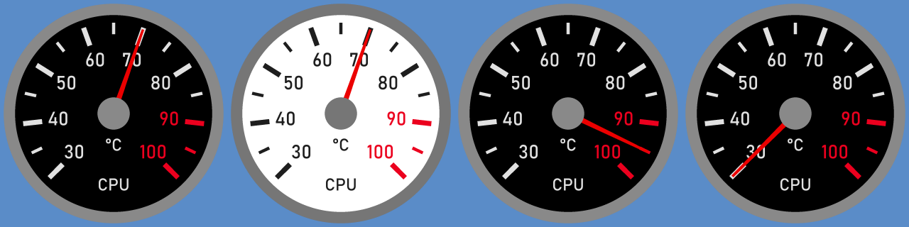

# CPU-Temp

The CPU temperature on a small round gauge for the Windows desktop, in
the style of a classic car's temperature gauge, written in Python.



The gauge floats on top of other windows with no frame, title bar or
taskbar button. Its edges are smoothly blended with whatever is behind
it, and it stays sharp at any display scaling, including when moved
between monitors with different scaling.

The needle starts at the bottom of the scale and swings up to the
temperature, then glides to each new reading, once a second.

## Where the Temperature Comes From

From Windows' performance counter *Thermal Zone Information*, the zone
the computer's firmware calls `CPUZ`. It needs no driver and no
administrator rights, but it is in whole degrees, and it follows the
CPU zone as the firmware sees it, a little calmer than the per-core
temperatures that tools like HWiNFO show. Not every computer has this
zone; without it the needle stays at the bottom of the scale. To see
which zones a computer has, run in PowerShell:

```
Get-Counter '\Thermal Zone Information(*)\Temperature'
```

The values are in kelvin (subtract 273 for degrees Celsius); 273 means
the zone is empty.

## Requirements

- Windows 10 or 11
- Python 3
- [Pillow](https://python-pillow.org/)

```
pip install pillow
```

## Running

```
python CPU-Temp.py
```

To start it without a console window, use `pythonw` instead:

```
pythonw CPU-Temp.py
```

## Using

- **Left-drag** the gauge to move it anywhere on the screen.
- **Right-click** it for a menu with **Zoom** (0.5x to 4x),
  **Invert Colors** and **Exit**. Zooming keeps the upper left corner of
  the gauge where it is. Inverting gives a white face with black ticks;
  the needle and the red ticks stay as they are.

The gauge remembers where it is, its zoom and its colours, in
`%APPDATA%\CPU-Temp\settings.json`, so it comes back as it was after a
reboot. **Exit** forgets them: the next start is at the starting
position, zoom and colours again. The starting position, right of
[Net-Eye](https://github.com/Niceno/Net-Eye),
[Win-Eyes](https://github.com/Niceno/Win-Eyes) and
[SBB-Uhr](https://github.com/Niceno/SBB-Uhr), keeps the four apart.

## Settings

The look and behaviour are set by constants at the top of
`CPU-Temp.py`. All dimensions are in pixels at 100 % display scaling
and grow with Windows scaling.

| Setting              | Meaning                                         |
|----------------------|-------------------------------------------------|
| `SIZE`               | Width and height of the gauge                   |
| `ZOOM`               | Starting zoom (changeable from the menu)        |
| `ZOOMS`              | Zoom choices offered in the menu                |
| `INVERT`             | Start with inverted colours (changeable too)    |
| `START_X`, `START_Y` | Starting position of the upper left corner      |
| `READ_MS`            | How often the temperature is read (ms)          |
| `FRAME_MS`           | How often the needle moves while it moves (ms)  |
| `GLIDE_MS`           | How quickly the needle follows a new reading    |
| `ZONE`               | The thermal zone shown                          |
| `T_MIN`, `T_MAX`     | The scale, in degrees Celsius                   |
| `T_RED`              | Ticks from here up are red                      |
| `ANGLE`              | The scale runs from -`ANGLE` to +`ANGLE` degrees |
| `*_COLOR`            | Colours of the face, bezel, ticks, hub, needle  |
| `FONT`               | Font of the numbers and labels                  |

The default scale, 30 to 100 °C with red from 90, suits laptop CPUs
like the Intel Core i5-8350U, which slow themselves down at 100 °C.

## Origin

The borderless, alpha-blended window comes from
[SBB-Uhr](https://github.com/Niceno/SBB-Uhr) and
[Win-Eyes](https://github.com/Niceno/Win-Eyes).

## License

Released under the [MIT License](LICENSE).
