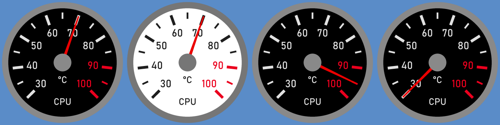

# SBB-Uhr

The Swiss railway clock (SBB Uhr) as a small window on the Windows
desktop, written in Python.



The clock floats on top of other windows with no frame, title bar or
taskbar button. Its edges are smoothly blended with whatever is behind
it, and it stays sharp at any display scaling, including when moved
between monitors with different scaling.

The hands move like the real thing: the second hand goes round in
58.5 seconds and waits at 12 until the full minute, when the minute hand
jumps forward with a small elastic swing.

## Requirements

- Windows 10 or 11
- Python 3
- [Pillow](https://python-pillow.org/)

```
pip install pillow
```

## Running

```
python SBB-Uhr.py
```

To start it without a console window, use `pythonw` instead:

```
pythonw SBB-Uhr.py
```

## Using

- **Left-drag** the clock to move it anywhere on the screen.
- **Right-click** it for a menu with **Zoom** (0.5x to 4x),
  **Invert Colors** and **Exit**. Zooming keeps the upper left corner of
  the clock where it is. Inverting gives a black face with white ticks and hands; the
  second hand stays red.

The clock remembers where it is, its zoom and its colours, in
`%APPDATA%\SBB-Uhr\settings.json`, so it comes back as it was after a
reboot. **Exit** forgets them: the next start is at the starting
position, zoom and colours again. The starting position, right of
[Net-Eye](https://github.com/Niceno/Net-Eye) and
[Win-Eyes](https://github.com/Niceno/Win-Eyes), keeps the three apart.

## Settings

The look and behaviour are set by constants at the top of `SBB-Uhr.py`.
All dimensions are in pixels at 100 % display scaling and grow with
Windows scaling.

| Setting         | Meaning                                              |
|-----------------|------------------------------------------------------|
| `SIZE`          | Width and height of the clock                        |
| `ZOOM`          | Starting zoom (changeable from the menu)             |
| `ZOOMS`         | Zoom choices offered in the menu                     |
| `FRAME_MS`      | How often the hands are updated (ms)                 |
| `BEZEL`         | Grey ring around the face (`True`) or none (`False`) |
| `BEZEL_WIDTH`   | Width of the grey ring, in units of the 105-wide face |
| `INVERT`        | Start with inverted colours (changeable from the menu) |
| `START_X`, `START_Y` | Starting position of the upper left corner      |
| `CYCLE_SECONDS` | Time the second hand takes to go round               |
| `EASING_MS`     | Duration of the minute and hour hands' swing (ms)    |
| `*_COLOR`       | Colours of the face, bezel, ticks and hands          |

## Origin

The geometry and motion come from SBB's JavaScript clock
(`sbbUhr-1.3.js`, "Digital SBB Uhr V 1.3", by SBB AG) in the
[`digital-clock`](https://github.com/sbb-design-systems/brand-elements/tree/main/digital-clock)
folder of SBB's [brand-elements](https://github.com/sbb-design-systems/brand-elements)
repository, from which this one is forked. SBB no longer maintains it
and points to the clock in the
[Lyne Design System](https://digital.sbb.ch/en/design-system/lyne/components/clock/)
instead.

The borderless, alpha-blended window comes from
[Win-Eyes](https://github.com/Niceno/Win-Eyes).

## License

The code is released under the [Apache License 2.0](LICENSE),
like the JavaScript it is based on. The SBB name and the design of the
SBB clock are trademarks of SBB AG and are not covered by this license.
