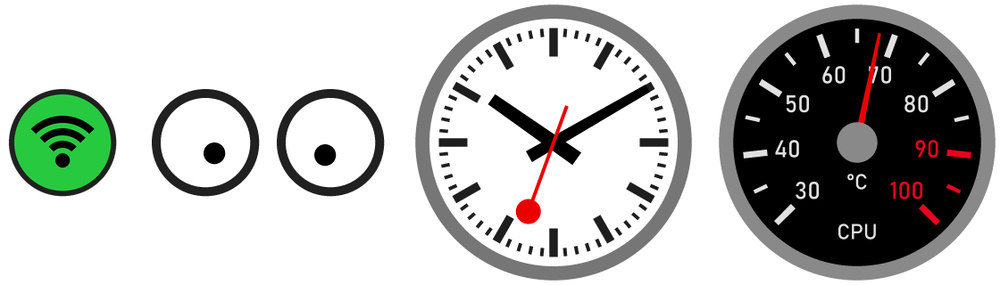
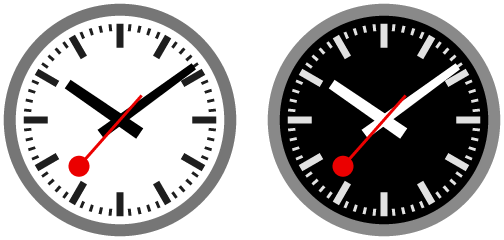
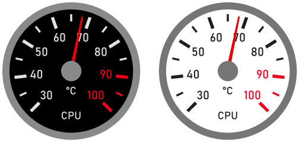

# Desk-Toys

Four small toys for the Windows desktop, written in Python: an
internet-connection light, a pair of eyes that follow the mouse, the
Swiss railway clock, and a CPU temperature gauge.



| Toy | What it shows |
|---|---|
| [**Net-Eye**](#net-eye) | Whether the internet is reachable: green or red |
| [**Win-Eyes**](#win-eyes) | Two eyes following the mouse, like the classic `xeyes` |
| [**SBB-Uhr**](#sbb-uhr) | The Swiss railway clock, with its famous second hand |
| [**CPU-Temp**](#cpu-temp) | The CPU temperature, on a car-style gauge |

All four float on top of other windows with no frame, title bar or
taskbar button. Their edges are smoothly blended with whatever is
behind them, and they stay sharp at any display scaling, including when
moved between monitors with different scaling. Each is a single file
and runs on its own.

## Requirements

- Windows 10 or 11
- Python 3
- [Pillow](https://python-pillow.org/)

```
pip install pillow
```

## Running

```
python Net-Eye.py
python Win-Eyes.py
python SBB-Uhr.py
python CPU-Temp.py
```

To start them without a console window, use `pythonw` instead of
`python`.

## Using

- **Left-drag** a toy to move it anywhere on the screen.
- **Right-click** it for its menu, which always has **Exit**.

Each toy remembers where it is (and its zoom and colours, where it has
them) in `%APPDATA%\<Toy>\settings.json`, so it comes back as it was
after a reboot. **Exit** forgets them: the next start is at the
starting position, zoom and colours again. A saved position on a
monitor that is no longer connected falls back to the start too.

The starting positions put the four in a row along the top of the
screen, 10 pixels apart (at 100 % display scaling; the positions grow
with the scaling, like the sizes):

| Toy | Starts at | Width |
|---|---:|---:|
| Net-Eye | 10, 10 | 70 |
| Win-Eyes | 90, 10 | 140 |
| SBB-Uhr | 240, 10 | 160 |
| CPU-Temp | 410, 10 | 160 |

Each toy is set by constants at the top of its file. All dimensions
are in pixels at 100 % display scaling and grow with Windows scaling.
The tables below list them.

## Net-Eye

A round light that checks every five seconds whether the internet is
reachable: **green** with the Wi-Fi arcs when it is, **red** with just
the dot when it isn't, **grey** before the first check. Every few
checks, and on **Check now**, the arcs build up one by one while it
checks.

It asks `https://www.google.com/generate_204`, which answers with an
empty "204" page. A captive portal (a hotel's or a train's login page)
answers with its own page instead, so Net-Eye shows red until you have
logged in.

Menu: **Check now**, **Exit**.

| Setting | Meaning |
|---|---|
| `SIZE` | Width and height of the light |
| `CHECK_EVERY_MS` | How often the connection is checked (ms) |
| `TIMEOUT_SECONDS` | How long a check may take before it counts as offline |
| `ARC_STEP_MS` | Delay between arcs while a check is animated (ms) |
| `ANIMATE_EVERY` | Animate every n-th check (1 = every check) |
| `START_X`, `START_Y` | Starting position of the upper left corner |
| `GREEN`, `RED`, `GRAY` | Colours of the light |
| `WIFI_*` | Position, size and colour of the Wi-Fi icon |

## Win-Eyes

A pair of eyes that follow the mouse, in the spirit of the classic
Unix `xeyes`. Each pupil looks towards the mouse pointer, stopping at
the edge of its eye. When the pointer is inside an eye, the pupil sits
right under it.

Menu: **Zoom** (0.75x to 4x), **Exit**. Zooming keeps the upper left
corner in place.

| Setting | Meaning |
|---|---|
| `SIZE` | Size of one eye; the window is two eyes wide |
| `ZOOM` | Starting zoom (changeable from the menu) |
| `ZOOMS` | Zoom choices offered in the menu |
| `START_X`, `START_Y` | Starting position of the upper left corner |
| `FOLLOW_MS` | How often the mouse position is checked (ms) |
| `PUPIL_RADIUS` | Radius of the pupil |
| `PUPIL_GAP` | Smallest gap between the pupil and the eye outline |
| `EYE_MARGIN` | Transparent space around each eye |
| `EYE_OUTLINE` | Thickness of the eye outline |
| `EYE_COLOR` | Colour of the eye whites |
| `OUTLINE_COLOR` | Colour of the eye outline |
| `PUPIL_COLOR` | Colour of the pupils |

## SBB-Uhr

The Swiss railway clock (SBB Uhr). The hands move like the real thing:
the second hand goes round in 58.5 seconds and waits at 12 until the
full minute, when the minute hand jumps forward with a small elastic
swing.



Menu: **Zoom** (0.5x to 4x), **Invert Colors**, **Exit**. Inverting
gives a black face with white ticks and hands; the second hand stays
red.

| Setting | Meaning |
|---|---|
| `SIZE` | Width and height of the clock |
| `ZOOM` | Starting zoom (changeable from the menu) |
| `ZOOMS` | Zoom choices offered in the menu |
| `FRAME_MS` | How often the hands are updated (ms) |
| `BEZEL` | Grey ring around the face (`True`) or none (`False`) |
| `BEZEL_WIDTH` | Width of the grey ring, in units of the 105-wide face |
| `INVERT` | Start with inverted colours (changeable from the menu) |
| `START_X`, `START_Y` | Starting position of the upper left corner |
| `CYCLE_SECONDS` | Time the second hand takes to go round |
| `EASING_MS` | Duration of the minute and hour hands' swing (ms) |
| `*_COLOR` | Colours of the face, bezel, ticks and hands |

The face, ticks and hands, and the way the hands move, are translated
from SBB's own JavaScript clock; see [Origins](#origins).

## CPU-Temp

The CPU temperature on a round gauge, in the style of a classic car's
temperature gauge: 30 to 100 °C over three quarters of the circle, red
from 90. The needle starts at the bottom and swings up, then glides to
each new reading, once a second.



Menu: **Zoom** (0.5x to 4x), **Invert Colors**, **Exit**. Its colours
are SBB-Uhr's inverted, so the two match side by side: the black
gauge with SBB-Uhr inverted, the white one with SBB-Uhr as it is.

The temperature comes from Windows' performance counter *Thermal Zone
Information*, the zone the firmware calls `CPUZ`. It needs no driver
and no administrator rights, but it is in whole degrees, and a little
calmer than the per-core temperatures that tools like HWiNFO show. Not
every computer has this zone; without it the needle stays at the
bottom of the scale. To see which zones a computer has, run in
PowerShell:

```
Get-Counter '\Thermal Zone Information(*)\Temperature'
```

The values are in kelvin (subtract 273 for degrees Celsius); 273 means
the zone is empty.

| Setting | Meaning |
|---|---|
| `SIZE` | Width and height of the gauge |
| `ZOOM` | Starting zoom (changeable from the menu) |
| `ZOOMS` | Zoom choices offered in the menu |
| `INVERT` | Start with inverted colours (changeable from the menu) |
| `START_X`, `START_Y` | Starting position of the upper left corner |
| `READ_MS` | How often the temperature is read (ms) |
| `FRAME_MS` | How often the needle moves while it moves (ms) |
| `GLIDE_MS` | How quickly the needle follows a new reading (ms) |
| `ZONE` | The thermal zone shown |
| `T_MIN`, `T_MAX` | The scale, in degrees Celsius |
| `T_RED` | Ticks from here up are red |
| `ANGLE` | The scale runs from -`ANGLE` to +`ANGLE` degrees |
| `*_COLOR` | Colours of the face, bezel, ticks, hub and needle |
| `*_RADIUS`, `*_TICK`, `*_SIZE` | The gauge's proportions, in units of 120 |
| `FONT` | Font of the numbers and labels |

The default scale suits laptop CPUs like the Intel Core i5-8350U,
which slow themselves down at 100 °C.

## Origins

Net-Eye came first, as a small Tkinter window, and was rewritten with
a borderless, alpha-blended Win32 window. Win-Eyes grew out of it,
SBB-Uhr took its window from Win-Eyes, and CPU-Temp from SBB-Uhr. The
first three started in repositories of their own, whose histories are
merged into this one.

SBB-Uhr is a Python translation of `sbbUhr-1.3.js` ("Digital SBB Uhr
V 1.3", by SBB AG) from the
[`digital-clock`](https://github.com/sbb-design-systems/brand-elements/tree/main/digital-clock)
folder of SBB's
[brand-elements](https://github.com/sbb-design-systems/brand-elements)
repository, under the Apache License 2.0. SBB no longer maintains it
and points to the clock in the
[Lyne Design System](https://digital.sbb.ch/en/design-system/lyne/components/clock/)
instead. See [NOTICE](NOTICE).

## License

Released under the [Apache License 2.0](LICENSE), like the JavaScript
clock SBB-Uhr is based on. The SBB name and the design of the SBB
clock are trademarks of SBB AG and are not covered by this license.
